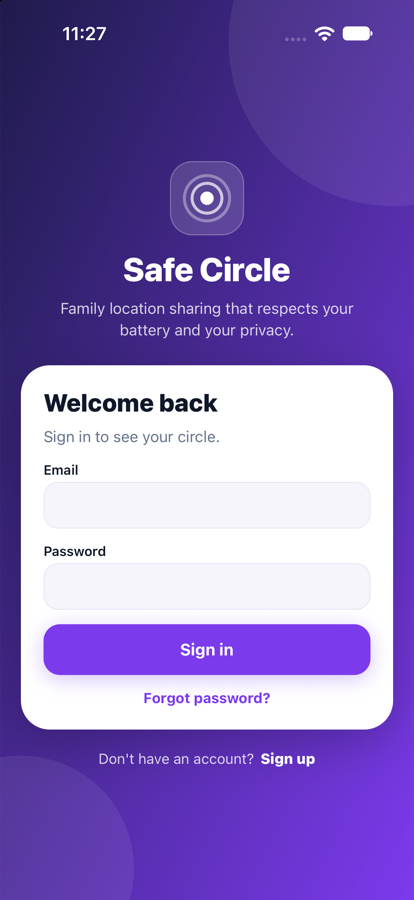
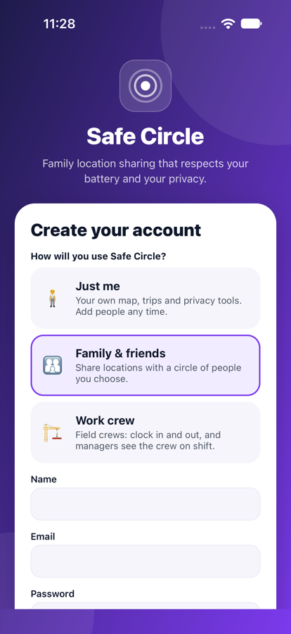
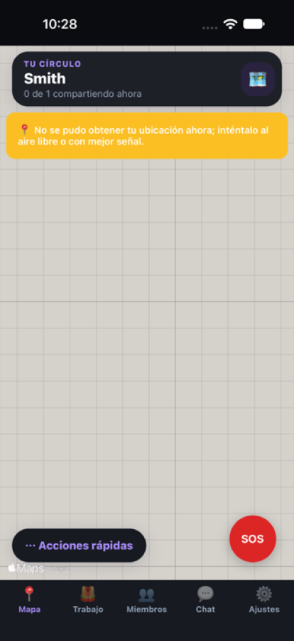
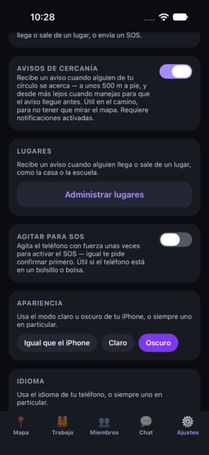
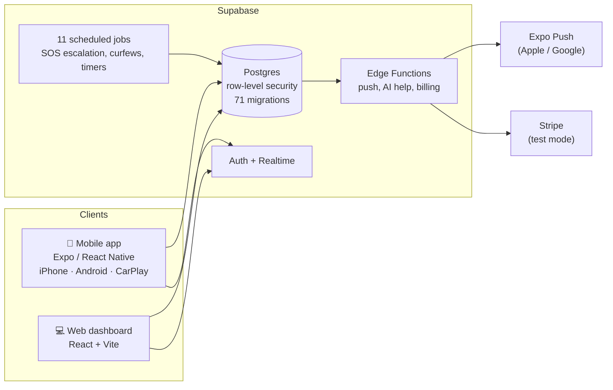

<div align="center">


# Safe Circle

**Location sharing and safety for families and for people who work alone, built so your location is shared only with the people you choose, only for as long as you choose.**

iPhone · Android · CarPlay · Web dashboard · English and Español


Created, designed and developed by **[Surendra B K](https://github.com/surendr7a)**

</div>

<p align="center">
  
  
  
  
</p>

---

## Contents

- [Why Safe Circle](#why-safe-circle)
- [Features](#features)
- [Privacy and security](#privacy-and-security)
- [Accessibility and Spanish](#accessibility-and-spanish)
- [How it's built](#how-its-built)
- [Testing](#testing)
- [Getting started](#getting-started)
- [Demo day](#demo-day)
- [Project structure](#project-structure)
- [Known limits](#known-limits)
- [Author and license](#author-and-license)

## Why Safe Circle

Most location apps are all-or-nothing: everyone sees you all the time, which feels like surveillance, so people turn it off, and then nobody knows when they need help. People who work alone have the opposite problem: their employer needs to know they're safe on shift, and nothing more.

Safe Circle is one account with two kinds of circle:

| | Family circles | Work organizations |
|---|---|---|
| Who | People you choose | A crew, its managers and owner |
| Who sees you | Your circle, while you share | Your managers, **only while you're clocked in** |
| Cost | Always free | $4 per worker seat a month (demo and Stripe test billing) |

## Features

### Safety

- **SOS**: one tap (or a hard shake) alerts your circle with your location, with **Call 911** on the same prompt. Circle-mates tap "I'm on my way"; an SOS nobody answers is pushed again automatically. No internet? It offers a **text message** with your location instead.
- **Fall and crash detection**: a hard fall followed by stillness opens a 30-second, vibrating "Are you OK?"; no answer sends the SOS for you.
- **Walk me home** and **Check on me**: timers that send an SOS on their own if you don't arrive or check in, counting down on the **lock screen and Dynamic Island** (in builds made with the Live Activity extension).
- **Curfew**: your circle is alerted if you're not home by a set time, in your own time zone.
- **Medical card**: readable by your circle only during an active SOS.
- **Backup contacts**: people outside the app to text in an emergency.

### Getting around

- **Directions** with turn-by-turn voice, lane hints, speed limits, stops along the way and incident reports, on the phone and on **CarPlay**.
- **Share your trip**: your circle sees where you're headed and when you'll arrive; works for drives, walks, buses, trains and flights.
- **Live links**: share your location or ETA with someone who doesn't have the app, until you arrive or the link expires.
- **Need a ride**: alerts only circle-mates who are driving near you right now.

### Your circle

- Live map with photos, battery, driving speed and weather where they are; **places** with arrive/leave alerts; **chat** and one-tap **check-ins**; meetup **pins**; **quick status** ("On my way", "Studying").

### Work mode, for people who work alone

- Workers **clock in** after reading a plain-language disclosure of exactly what their employer can see; any change has to be accepted again.
- Managers see a **live crew map** only of people on shift, only of the teams they lead. Shifts end by themselves after 14 hours.
- Optional **check-ins**: a missed one alerts the managers. A phone that goes **quiet** for about 20 minutes on shift alerts them too.
- Every time a manager looks at a worker's location, the worker sees it in **"Who's looked at you"**.
- **Incident reports**: a worker reports a hazard, a near miss or an injury with a note and a photo; the people who oversee them are alerted at once and mark it resolved. The position goes with it only on shift.
- **Safety report**: week by week on the web dashboard: hours, SOS alerts and how fast someone answered, missed check-ins, quiet phones, incidents and location views, for the whole crew or a manager's teams.
- **Job-site reminders** that never leave the worker's phone; **timesheets** with a payroll CSV (times only, never places).
- A **web dashboard** for owners and managers, and a platform view that shows totals only.

## Privacy and security

The rules live in the database, not just the app: **row-level security on every table** decides who can read what, so they hold even for someone who builds their own client.

- Share for 1, 2 or 8 hours, or until you stop; **ghost mode** hides you from one person.
- **Location history** kept 1, 7 or 30 days or forever, your choice, deleted every night by the database.
- **Who's checked on me**: every look at your history is logged and shown to you.
- **App lock** with Face ID; **download all your data**; **delete your account** (circles you created pass to another member instead of vanishing).
- Invite codes are hashed and rate-limited; new members can need the creator's approval.
- A full [privacy policy](mobile/lib/privacyPolicy.ts), in English and Spanish, in the app and at the web dashboard's `/privacy`.

No ads, no analytics or tracking SDKs, nothing sold.

## Accessibility and Spanish

- **VoiceOver / TalkBack**: every control is named; errors and events ("SOS sent", "Clocked in") are read aloud; headings for the rotor; nothing hidden inside another button.
- **Large text** up to the biggest accessibility sizes; **dark mode** that follows the phone or a choice in Settings.
- **Web**: works from the keyboard with a visible focus ring, screen-reader labels, and WCAG AA contrast, checked by tests.
- **Español**: the whole app (729 phrases, turn-by-turn voice included) and the web dashboard follow the device's language or a choice in Settings. **Notifications arrive in each recipient's language.**

## How it's built



| Part | Tech |
|---|---|
| [`mobile/`](mobile/README.md) | Expo SDK 57, React Native, expo-router, react-native-maps, a native CarPlay module |
| [`web/`](web/README.md) | React, Vite, Leaflet |
| [`backend/`](backend/README.md) | Supabase: Postgres + RLS, Auth, Realtime, pg_cron, Edge Functions (Deno) |
| Maps and routes | Apple Maps / Google Maps, OpenStreetMap-based routing and search |

## Testing

Every push runs the whole suite on GitHub Actions, against a fresh database:

| Suite | What it checks | Size |
|---|---|---|
| Database security tests | Who can see whose location, curfews, shifts, SOS, billing, as each kind of user | 24 files, ~480 checks |
| Load test | 302 people and ~113,000 positions; the crew map answers in ~30 ms | 7 timed checks |
| Mobile app | Screens, logic, accessibility rules, translations, fall detection | 605 tests |
| Web dashboard | Logic, accessibility and contrast, translations, the privacy policy | 111 tests |
| Notifications | Every alert translated correctly for Spanish speakers | Node tests |
| Tap-through (Maestro) | Sign-in, tabs, check-in, Spanish, clocking in, on a simulator | 6 flows |

```bash
cd backend && tests/run_all.sh                 # database tests (local Supabase)
cd mobile && npm test                          # app tests
cd web && npm test                             # dashboard tests
cd mobile && scripts/e2e.sh                    # tap-through tests on the simulator
```

## Getting started

You need Node 22+, the [Supabase CLI](https://supabase.com/docs/guides/cli), and Xcode (iPhone) or Android Studio with Java 17 (Android).

1. **Backend**: `cd backend && supabase start` for a local stack, or `supabase link` to a hosted project and `supabase db push`. See [backend/README.md](backend/README.md).
2. **Environment**: copy [`.env.example`](.env.example) to `.env` at the repo root and fill in the Supabase URL and anon key. Both apps read it.
3. **Web dashboard**: `cd web && npm install && npm run dev`.
4. **Mobile app**: `cd mobile && npm install`, then
   ```bash
   npx expo run:ios --configuration Release        # iPhone (simulator or a plugged-in phone)
   npx expo run:android --variant release          # Android
   ```
   See [mobile/README.md](mobile/README.md) for signing, CarPlay and Android details.

## Demo day

```bash
cd backend
supabase db query --linked -f scripts/demo_seed.sql   # a demo crew with workers on shift
scripts/demo_check.sh                                 # READY, or what to fix first
supabase db query --linked -f scripts/demo_reset.sql  # remove the demo data afterwards
```

## Project structure

```
SafeCircle/
├── mobile/      Expo app: app/ (screens), components/, lib/ (logic + tests), hooks/, .maestro/
├── web/         React dashboard: src/components/, src/lib/
├── backend/     supabase/migrations/, supabase/functions/, tests/, scripts/
├── docs/        screenshots
└── .github/     CI
```

## Known limits

- Built with a free Apple developer account: a phone install has to be re-signed every 7 days, and push notifications to a phone need the paid program.
- The Android map needs a Google Maps API key; Android push needs a Firebase project.
- Fall detection works while the app is open (phones give apps motion data while they're open).
- Card payments run in Stripe **test mode** only.

## Author and license

**Surendra B K** — creator and developer of Safe Circle: the backend, the mobile app, the web dashboard, the tests and the CI.
GitHub: [@surendr7a](https://github.com/surendr7a)

CS capstone project, Fall 2026.

Released under the [MIT License](LICENSE).
